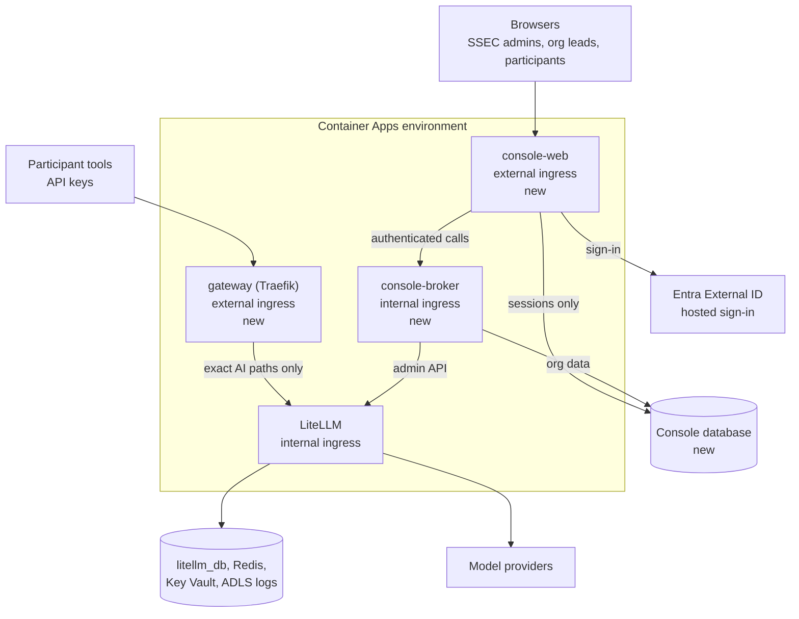

# LLMoxie Console on the Azure Stack: Design

- **Date:** 2026-11-06
- **Owner:** Don
- **Status:** Draft, awaiting Don's review
- **Related:** [#193](https://github.com/uw-ssec/llmoxie/issues/193),
  [#200](https://github.com/uw-ssec/llmoxie/issues/200)
- **Replaces, for now:** the Nebari and Helm path in
  [`docs/specs/2026-11-02-multi-tenant-hub-design.md`](https://github.com/uw-ssec/llmoxie/blob/docs/multi-tenant-hub-spec/docs/specs/2026-11-02-multi-tenant-hub-design.md).
  That spec's research goal still applies unless this one says otherwise.

## Goal

For the next workshop, org leads control LiteLLM without logging in to the
LiteLLM UI. They use an LLMoxie console instead, modeled on CloudBank's flow: a
login page with one sign-in button, then a hosted sign-in page, then our own
dashboard. LiteLLM becomes an internal service, so direct access to it is rare
and can be monitored closely.

## Non-goals

- Nebari, Kubernetes, Helm, Keycloak and other clouds.
- Analytics screens in the first version. They come when `llmoxie-analysis` has
  results a dashboard can read.
- Reproducing the whole LiteLLM UI. The console has only the screens below.
- LiteLLM Enterprise features.
- Client-side agent telemetry. Only what crosses the proxy is logged.
- Verified institution identity. CILogon is tabled as a future improvement for
  when that's needed, and swapping providers mainly changes the login step.

**This fails even if it technically works when:** an org lead can see or change
another org's data, a participant can reach a management route from the
internet, or turning the features off changes an existing deployment.

## Decisions

Calls marked "Proposed" are the author's and are open to change on review.

| #   | Decision                                                                                        | Source   |
| --- | ----------------------------------------------------------------------------------------------- | -------- |
| 1   | Add services to the current Container Apps stack; no Nebari                                     | Don      |
| 2   | Log in through Microsoft Entra External ID; land on our own dashboard                           | Don      |
| 3   | Org leads create teams, add models, set budgets, add users, see analytics, archive teams        | Don      |
| 4   | Participants get an invite link that registers them, then sign in through External ID           | Don      |
| 5   | Each user can create up to n API keys                                                           | Don      |
| 6   | An invite works only if the sign-in email matches the invited address; leads approve exceptions | Don      |
| 7   | Forward only AI access paths to LiteLLM; no management paths                                    | Don      |
| 8   | Orgs bring their own provider keys and pay their providers                                      | Hub spec |
| 9   | Consent is captured before keys, with a separate research-use opt-out                           | Hub spec |
| 10  | No Keycloak. The roster lives in the console database                                           | Proposed |
| 11  | LiteLLM's ingress becomes internal, behind a new public gateway app                             | Proposed |
| 12  | Split the console into a public `console-web` and an internal `console-broker`                  | Proposed |
| 13  | Provider keys belong to the org; each team picks from the org's models                          | Proposed |
| 14  | Consent is per team (workshop)                                                                  | Proposed |
| 15  | Python, in this repo, server-rendered pages with minimal JavaScript                             | Proposed |
| 16  | A compromised `console-web` can't act as an arbitrary user: the broker verifies the user itself | Proposed |
| 17  | Leads see per-person spend and usage, but never prompt or response content in the console       | Proposed |
| 18  | One shared LiteLLM for the first workshop, accepting risk O6                                    | Proposed |
| 19  | Email one-time passcode is the only sign-in method in the first version                         | Proposed |
| 20  | Self-service sign-up stays on in External ID; the console decides access                        | Proposed |
| 21  | Org leads and SSEC admins must pass MFA for their screens; participants don't                   | Proposed |

## Architecture

**New Container Apps**

- **`gateway`:** Traefik with the file provider, reusing `resources/traefik.py`
  and `DEFAULT_PUBLIC_PATHS` and `DEFAULT_HEALTH_PATHS` from `config/schema.py`.
  It forwards listed exact paths to LiteLLM's internal address and refuses
  everything else. There is no admin route in its configuration at all. It keeps
  the per-replica, per-client-IP rate limit and streaming flush from #217.
- **`console-web`:** public. Login, sessions, pages, CSV upload, invite links.
  It holds no LiteLLM credential and no access to org data. Its database role
  covers only its session table.
- **`console-broker`:** internal ingress. It holds the LiteLLM admin key and
  exposes fixed operations such as `issue_key` and `archive_team`, with no
  passthrough. It builds LiteLLM requests from fixed templates, so a caller
  can't choose a `user_id`, role or route. All org data goes through the broker,
  and each call carries a short-lived signed assertion of the acting user that
  the broker verifies against the login, so `console-web` can't simply claim to
  be someone.

**Changes to existing apps**

- LiteLLM gets `ingress_external=False` when the gateway is on. Custom domains
  move to the gateway. The gateway and the Traefik sidecar (`litellm.proxy`) are
  mutually exclusive, enforced in config validation.
- LiteLLM UI: `DISABLE_ADMIN_UI=true` when the console is on.
- The console database is added to `database.databases` on the existing Flexible
  Server, with separate roles for the web tier and the broker. Neither has
  access to `litellm_db`.

**Limits of Container Apps, stated plainly**

- Internal ingress means reachable from every app in the environment, so MLflow
  and the backup job can reach LiteLLM and the broker. The broker authenticates
  its callers, and LiteLLM still requires a key. A separate environment for
  MLflow and backups is a later option.
- There are no per-app network policies, and restricting outbound traffic needs
  added infrastructure. See open items.
- Rule-based routing in the environment can expose internal apps, so don't use
  it for these apps.

**Compatibility rule:** `gateway.enabled` and `console.enabled` default to
false. With both off, the Pulumi plan is unchanged and `--expect-no-changes`
still passes. Turning the gateway on changes the public address for clients not
using a custom domain, so it needs notice to existing users.

## Identity and sign-in

**Entra External ID setup:** a separate external tenant owned by UW SSEC, an app
registration for `console-web` as a confidential client, and a sign-up and
sign-in user flow. External tenants are created in the Microsoft Entra admin
center by someone with the Tenant Creator role, and the tenant's location can't
be changed later. This setup is outside the Pulumi stack in the first version,
and the console's config holds only the tenant ID, client ID and a secret
reference. The core offer is
[free for the first 50,000 monthly users](https://learn.microsoft.com/entra/external-id/customers/faq-customers#external-id-pricing),
counted across tenants linked to a subscription. SMS and client-credentials
calls are
[paid add-ons](https://learn.microsoft.com/entra/external-id/external-identities-pricing),
so the design uses neither.

- **Sign-in method:** email one-time passcode only. A code sent to the invited
  address proves control of it, and any partner can use it. Google, Microsoft
  accounts or other providers can be added once we've confirmed their email
  claim can be trusted for invite matching.
- **Sign-up stays on,** since a first sign-in is a sign-up. Accounts with no
  console membership get nothing. Disabling it would need the console to create
  accounts through Microsoft Graph, which adds another privileged credential.
- A person's identity is the tenant ID and object ID from the token. Email is
  only used to match invites, and the plan must confirm how the email claim is
  issued.
- Each person gets a console-generated `participant_id`, which becomes LiteLLM's
  `user_id`. Logs carry that ID, never the email or the External ID object ID.
  Prompts can still contain identifying text.
- Signing in grants nothing by itself. Without a membership, a login gets a "not
  invited" page.
- Sessions follow the backend-for-frontend pattern recommended by
  [RFC 10017](https://www.rfc-editor.org/rfc/rfc10017.txt): authorization code
  with PKCE, tokens only on the server, Secure, HttpOnly, SameSite=Strict
  `__Host-Http-` cookies and a CSRF defense. Sign-in code uses a maintained OIDC
  library.
- Re-authentication (`prompt=login`) is required for provider key changes and
  org-level actions.
- **MFA:** org leads and SSEC admins complete MFA through a Conditional Access
  [authentication context](https://learn.microsoft.com/entra/external-id/customers/concept-multifactor-authentication-customers#step-up-mfa-with-conditional-access-authentication-context)
  before reaching their screens. With email passcode as the first factor, the
  second factor is an authenticator app (TOTP), since Microsoft doesn't offer
  passkeys for those users and SMS costs extra. The console checks the token's
  claim rather than trusting the redirect. Participants aren't asked for MFA.
- Dormant accounts lose access automatically, and memberships are reviewed.
- First SSEC admins come from deployment config, by identity.

## Roles and screens

Authorization is deny-by-default in one policy module, and the org and team come
from the session and database, never the request. `console-web` and
`console-broker` both enforce it. Postgres row-level security adds a third
check.

| Role        | Can do                                                                                             |
| ----------- | -------------------------------------------------------------------------------------------------- |
| SSEC admin  | Create and suspend orgs, set org budget ceilings, appoint org leads, view all orgs, read audit log |
| Org lead    | In their org only: everything in "Org lead's workshop" below                                       |
| Participant | In their teams only: see consent choices, create and delete their own keys, see their own usage    |

**Org lead's workshop**

1. **Create a team.** Console record plus LiteLLM team (`/team/new`). Set the
   key limit n, per-key budget, expiry and consent form.
2. **Add provider keys and models.** The lead enters a provider and key. The
   broker registers `<org>/<model>` through `/model/new` and adds names to the
   team's allowlist. Keys are write-only and never returned or logged. Only
   known provider hostnames are allowed, so a custom URL can't send a key
   elsewhere. Per-account providers such as Azure need a suffix pattern, which
   is a weaker check.
3. **Set the team budget,** up to the org's ceiling. Budgets are guard rails,
   since orgs pay providers directly.
4. **Add users,** singly or by CSV. Each gets an invite.
5. **Watch usage** during the workshop: per-person spend and request counts from
   `/spend/logs` and team info, filtered to the team. The broker strips prompt
   and response content, since `store_prompts_in_spend_logs` is on in
   `docker/config.yaml`. The consent form must say that leads can see per-person
   usage. See open items on analytics.
6. **Archive.** See below.

**Participant registration**

1. The invite link opens a page. It's single-use and expiring, the token is
   stored hashed, and pages use `no-store` and `no-referrer`. Only a POST
   consumes it, so email scanners can't.
2. The person signs in through External ID with a code sent to their email.
3. If the sign-in email matches the invite, the identity is bound and the invite
   consumed. If it doesn't match, or the token has no email, the request goes to
   the lead to approve, and no access is granted until then.
4. The person accepts the workshop terms and separately chooses research use. No
   consent means no key. Consent records are append-only.
5. They land on their page and can create up to n keys. Each is shown once.

Later visits go straight to that page. A second invite adds a team to the same
account. Removing someone deletes their keys in that team.

**Keys:** `/key/generate` with `team_id`, `user_id` and the team's budget and
expiry. LiteLLM has no per-user key count that this design relies on, so the
broker enforces n in a transaction. Total spend per person is bounded by n times
the per-key budget, and the team budget is the hard ceiling. In local testing, a
`max_budget` on the LiteLLM user didn't stop calls on team keys, so don't rely
on it.

**Archiving a team**

1. Delete all of the team's keys. This is what stops access.
2. Empty its allowlist and call `/team/block`. In local testing a key still
   worked immediately after `/team/block`, and a new key could be created on a
   blocked team, so blocking alone isn't enough.
3. Mark the team read-only in the console and keep records and logs under the
   retention rule.

Org models and provider keys stay until the lead removes them, since other teams
may use them.

## Secrets

- **Existing vault:** unchanged. It keeps one shared identity and one
  `AccessPolicy`, per `bugs/key-vault-access-policy-replace`.
- **New console vault, with new identities:** the broker's identity can read the
  LiteLLM admin key, and `console-web`'s identity can read only its session key
  and External ID client secret. Neither uses the shared identity.
- **The broker's admin key** is a `proxy_admin` user's key, not the master key,
  so it can be revoked without touching the master key. Treat it as full admin.
  How it's first created is left to the plan, but it must not pass through
  Pulumi state in plain text (see #219's class of problem).
- **Salt key prerequisite:** provider keys are encrypted with
  `LITELLM_SALT_KEY`, or the master key if unset. #200 must land first, and an
  existing database needs its documented opt-in, per
  `requirements/litellm-master-and-salt-key`.
- MLflow and the backup job can still read the master key through the shared
  identity. This design doesn't fix that.

## Logs and consent

`AdlLogger` and the MLflow callback stay, and so does the file layout, which
keeps `llmoxie-analysis`'s input working. The console adds a team-to-org and
participant-to-consent mapping. Whether the logged record carries the team ID
needs confirming during the plan.

**Prerequisite:** `AdlLogger` serializes the full callback `kwargs`. Credentials
must be removed from the record, with a test on a real record for each logging
callback, before any org enters a provider key.

The hub spec's consent rules apply: `research_use` is evaluated when data is
exported or analyzed, later changes affect only later uses, already exported
data can't be recalled, and the org's IRB confirms wording. Opted-out logs stay
for operations and are deleted at the end of the engagement, as in the hub spec.
Until retention jobs exist, that deletion is a documented manual step, and the
consent form states the period.

**Until exports exist,** anyone using logs for research must apply the console's
consent table. Consent-filtered exports and retention jobs come next, with
analytics.

## Monitoring

Extend `resources/monitoring.py` and `enabled_alerts` from #222.

- Every console action writes an append-only audit event: who, org, team,
  action, target and result. LiteLLM's own audit log needs a licence. Audit
  events are also sent to storage that the console can't rewrite.
- New alerts: LiteLLM management routes called with no matching broker audit
  event, the gateway refusing unusual volumes, cross-org denials, new admin
  keys, provider key changes and spend spikes.
- Log Analytics sees LiteLLM's request paths, but the caller's address is the
  platform proxy, so these alerts rely on comparing against the audit log. The
  plan has to prove this works.
- Alert rules get a test that fires them, and logs never contain keys or tokens.

## Security baseline

- Verify against [OWASP ASVS 5.0](https://asvs.owasp.org/): Level 2 overall, and
  Level 3 for authorization, tokens and secrets.
- A written threat model before the console skeleton.
- Images pinned by digest and signed, actions pinned by SHA, dependencies
  locked, and a small dependency set.
- An outside penetration test before the first real org.
- An incident runbook and a rotation drill for the admin key.

## Testing and acceptance

- **Cross-org and cross-team denial suite, required in CI:** every console route
  and broker operation rejects a lead or participant acting outside their scope,
  and the broker never calls LiteLLM with an out-of-scope target.
- **Gateway:** every listed path forwards, and every other path, alias, case
  variant and encoding is refused. Streaming works through the real gateway on
  Azure.
- **Internal ingress:** on staging, LiteLLM has no public address.
- **Invite:** matching email succeeds; mismatch, no email, reuse, expiry and
  link scanners all fail safely.
- **Keys:** the n limit holds under concurrent requests.
- **Archive:** after archiving, no team key works and none can be created.
- **No-op:** with both flags off, the plan is unchanged.
- **Acceptance:** a dry run on staging with at least one org, one lead and 10
  participants goes from login through archiving with no one using the LiteLLM
  UI, and direct management access raises an alert.

## Build order

1. **Prerequisites:** credential removal from logs, #200, Redis on, monitoring
   alerts configured.
2. **Gateway:** new app, LiteLLM internal, verified on staging.
3. **Console skeleton:** threat model, External ID login, org model, SSEC admin
   screens, broker, denial test harness, audit log.
4. **Teams:** provider keys, models, budgets, usage.
5. **Participants:** invites, exceptions, consent, keys.
6. **Archive, alerts, pen test, dry run.**
7. **Later:** exports, retention jobs, analytics screens, and CILogon if we need
   a verified institution.

## Open items

| #   | Item                      | Why it matters                                                                                                               |
| --- | ------------------------- | ---------------------------------------------------------------------------------------------------------------------------- |
| O1  | External tenant creation  | UW SSEC owns the tenant. Someone at SSEC needs the Tenant Creator role on the subscription, and UW IT may need to approve it |
| O2  | MFA licensing and setup   | Pricing docs don't list Conditional Access as an add-on, but this needs confirming, and the step-up flow needs a real test   |
| O3  | External ID outage        | Console login stops, but existing keys keep working. Needs a break-glass path that doesn't use External ID                   |
| O4  | Operator access           | How SSEC reaches LiteLLM directly once it's internal, and how that's logged                                                  |
| O5  | Outbound restrictions     | A fixed outbound IP lets orgs lock provider keys to us, but it needs added infrastructure and cost. Not verified             |
| O6  | Shared LiteLLM database   | It holds every org's provider keys. Capped, IP-restricted keys reduce the risk; a LiteLLM per org would contain it           |
| O7  | Email delivery            | Invites need a sender and a service                                                                                          |
| O8  | Hiding the org prefix     | Team aliases returned 200 in testing, but routing wasn't confirmed and the docs mark them deprecated                         |
| O9  | Analytics interface       | `llmoxie-analysis` has no results format yet, and its results must apply consent                                             |
| O10 | LiteLLM licensing         | Images include the `litellm-enterprise` package. Confirm with BerriAI what that means for production use                     |
| O11 | Existing users            | Moving current keys, spend history and client URLs is a separate plan before turning the gateway on in production            |
| O12 | Trace data classification | Ask UW's security office and the IRB what they require                                                                       |
| O13 | Workshop date and gates   | No date is set. It decides which security items and open items block the workshop, and when to book a pen test               |
| O14 | Which deployment          | The workshop runs on the existing stack (needs O11 first) or on a new deployment (needs new environments and cost)           |

## Left to the builder

Library and framework choices within decision 15, database schema, page design,
broker transport and caller authentication method, key-limit defaults, and the
rollout mechanics for each flag.

## Evidence

Local tests used LiteLLM 1.106.6 with no licence and mocked model responses:
cross-team denial, key and team limits, key delete and reissue, model add,
update and delete, and the `/team/block` and user-budget behavior noted above.
Nothing in this design has run on Azure.
